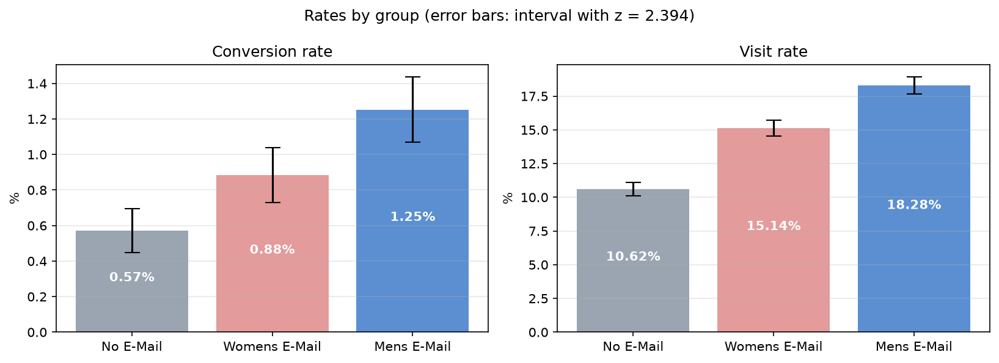
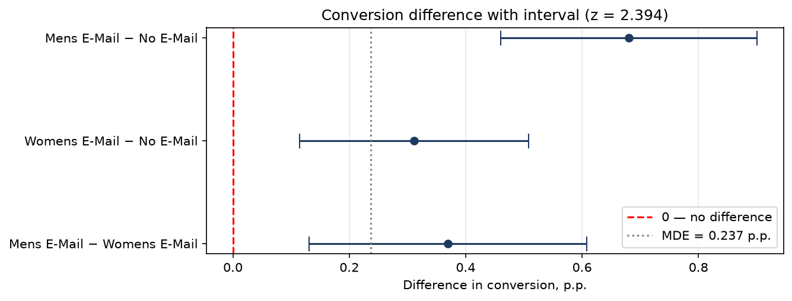
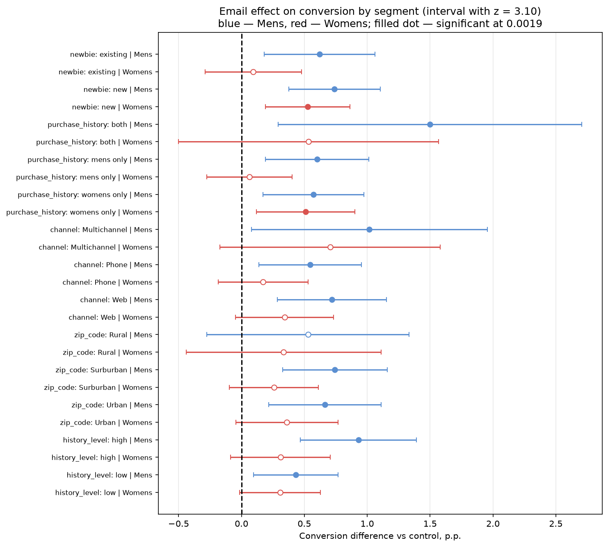

# Email Campaign A/B/C Test Analysis (Hillstrom)

Analysis of a randomized email experiment by an online clothing retailer: 64,000 customers were split into three groups —
**men's email**, **women's email** and **no email** (control) — and tracked for two weeks.

**Business question:** should the retailer send the email, and if so, which version and to whom?

## Key results

| Metric | No E-Mail | Women's email | Men's email |
|---|---|---|---|
| Visit rate | 10.62% | 15.14% | **18.28%** |
| Conversion rate | 0.57% | 0.88% | **1.25%** |
| Revenue per customer | 0.65 USD | 1.08 USD | **1.42 USD** |

| Comparison | Conversion | Visits | Revenue per customer |
|---|---|---|---|
| Men's − control | **+0.68 p.p.** (+119%), p < 0.001 | **+7.66 p.p.**, p < 0.001 | **+0.77 USD** (+118%), p < 0.001 |
| Women's − control | **+0.31 p.p.** (+54%), p < 0.001 | **+4.52 p.p.**, p < 0.001 | **+0.42 USD** (+65%), p = 0.001 |
| Men's − women's | **+0.37 p.p.** (+42%), p < 0.001 | **+3.14 p.p.**, p < 0.001 | +0.35 USD, p = 0.031 — not significant |

Significance threshold: 0.05 / 3 ≈ 0.0167 (Bonferroni correction for three comparisons).

- **Both emails work**: they increase visits, conversion and revenue per customer.
- **The men's email is the strongest**: it is significantly better than the women's email on visits and conversion; on revenue it is also higher, but the difference is not significant.
- **The revenue lift comes from more buyers, not bigger orders**: average order value does not change (about 114–122 USD in all groups).
- **The men's email works in almost every segment**, including customers who bought only women's products. The women's email works only for **new customers** and **women's-only buyers**.





## Recommendation

1. **Send the men's email to all customers.** Per 1,000 emails it brings about **+770 USD** in extra revenue (interval 422 to 1,118 USD), compared with +424 USD for the women's email.
2. Do not use the women's email as the main campaign; test it separately only for new customers and women's-only buyers.
3. Next experiment: a new version of the women's email, because it has no visible effect on existing customers.

With an assumed 40% margin and 10 USD per 1,000 emails sending cost, both emails pay off even at the lower bound of the interval.

## Methods

| Step | What was done |
|---|---|
| 2. Data quality check | types, missing values, value ranges, logical consistency, duplicates |
| 3. Descriptive statistics | rates by group, mean / median / mode / percentiles of revenue, histogram, boxplot |
| 4. Randomization check | sample ratio mismatch (z-test and exact binomial test vs 1/3), group balance on pre-experiment attributes |
| 5. Test power | minimum detectable effect (MDE) for conversion and visits at 80% power |
| 6. Proportion tests | two-proportion z-test and confidence intervals, checked with `statsmodels` |
| 7. Revenue tests | Welch t-test, bootstrap confidence interval, Mann–Whitney, average order value |
| 8. Segment analysis | effect of each email by customer segment, 26 comparisons with Bonferroni correction |
| 9. Business conclusion | extra visitors, buyers, revenue and profit per 1,000 emails |
| 10. Comparison | results compared with the winning entry of the original 2008 challenge |



## Comparison with other analyses

The overall results match exactly the [Stochastic Solutions uplift modelling paper](https://www.stochasticsolutions.com/pdf/HillstromChallenge.pdf)
that won the [MineThatData challenge](https://blog.minethatdata.com/2008/03/minethatdata-e-mail-analytics-and-data.html):
men's email +7.66 p.p. visits, +0.68 p.p. conversion and +0.77 USD per customer; women's email +4.52 p.p., +0.31 p.p. and +0.42 USD.
Both analyses find the strongest men's email effect among multichannel customers with high past-year spend, and a women's email effect among new customers.
They used uplift modelling to choose target customers; this project uses significance tests with confidence intervals, which also shows
that the revenue difference between the two emails is not significant.

## Limitations

- No guardrail metrics (unsubscribes, spam complaints), so the long-term cost of more email is unknown.
- Only a two-week window; the effect may partly be purchases moved earlier in time.
- Revenue is sales, not profit; margin and sending cost are assumptions.
- `spend` is capped at 499 USD; the data is from 2008.
- Segment results are exploratory and should be confirmed with a separate test.

## Data

Public dataset by Kevin Hillstrom (MineThatData), 64,000 rows × 12 columns, one row per customer.
Column descriptions: [data_dictionary.md](data_dictionary.md).

The CSV is not stored in the repository. Download it from the
[MineThatData blog post](https://blog.minethatdata.com/2008/03/minethatdata-e-mail-analytics-and-data.html)
and save it as `data/hillstrom.csv`.

## Project structure

```
hillstrom-ab-test/
├── data/                       # hillstrom.csv (not in the repository)
├── images/                     # charts used in this README
├── notebook/
│   └── hillstrom_ab_test.ipynb # full analysis, steps 1–10
├── outputs/                    # result tables (CSV)
├── data_dictionary.md
├── requirements.txt
└── README.md
```

## How to run

```bash
python -m venv .venv
source .venv/bin/activate        # Windows: .venv\Scripts\activate
pip install -r requirements.txt
jupyter notebook notebook/hillstrom_ab_test.ipynb
```

Run all cells from top to bottom. The notebook reads `../data/hillstrom.csv` and writes charts to `images/` and tables to `outputs/`.

## Tools

Python: pandas, NumPy, SciPy, statsmodels, matplotlib, seaborn.
